# Backoffice Structure

[Feature Guide](clean-features.md) > Backoffice structure

This page describes what Clean adds to the Umbraco backoffice: the document types and compositions, the categories in the Library section, the Data Types, the media types and the templates. It is aimed at developers who want to extend the starter kit, and at editors who want to know where things live.

---

## Contents

- [Library: categories](#library-categories)
- [Document types](#document-types)
- [Compositions](#compositions)
- [Element types for blocks](#element-types-for-blocks)
- [Data Types](#data-types)
- [Media types](#media-types)
- [Templates](#templates)
- [Models Builder](#models-builder)

---

## Library: categories

Categories are stored once, as elements in the **Library** section, and picked on each article. This means a category is renamed in one place and the change shows on every article that uses it.

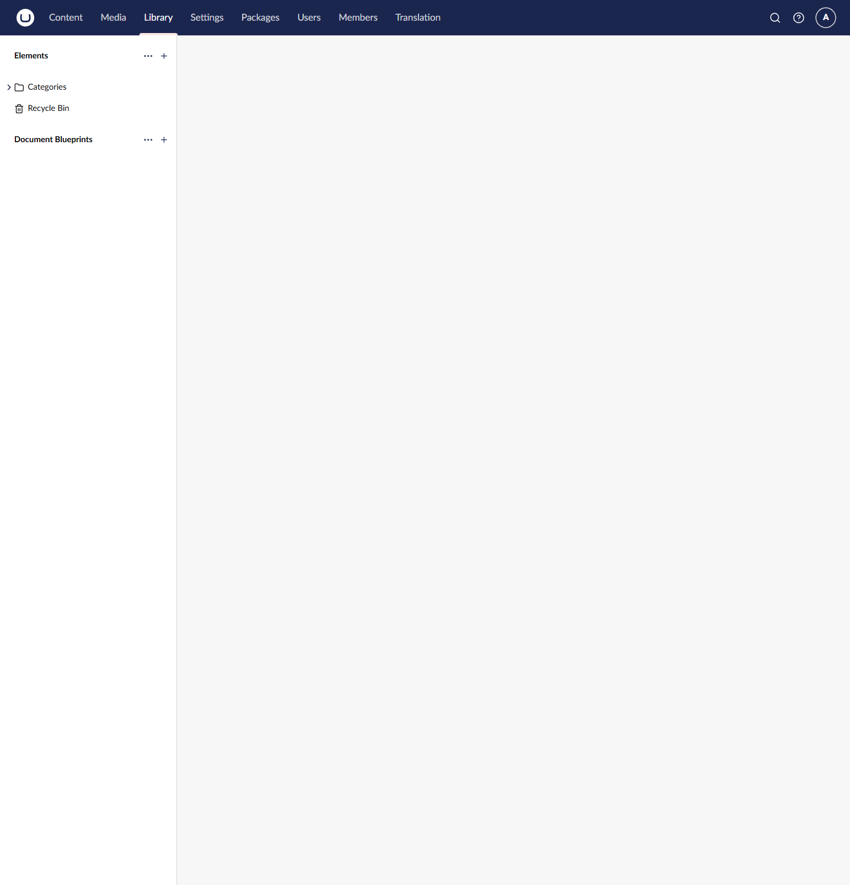

The sample content has a **Categories** folder with seven categories:

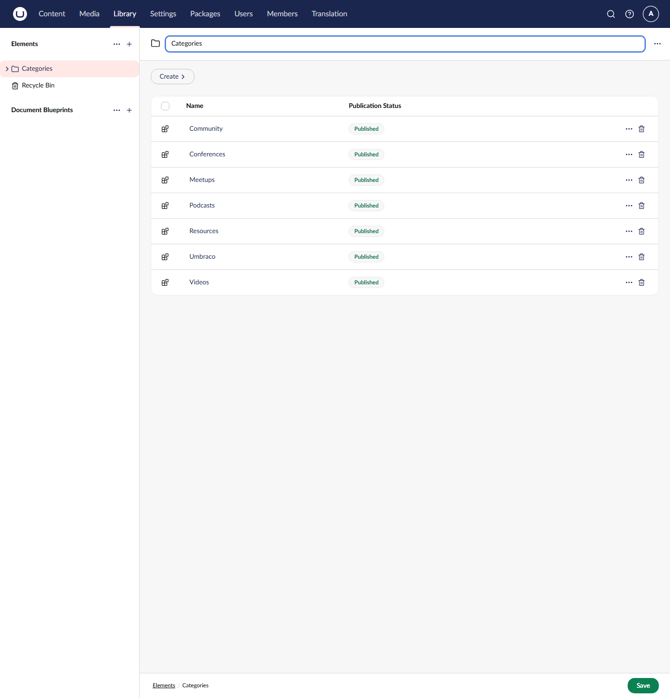

Each category is a **Category Element**, which has no fields: the element's name is the category. Categories are published like content, and the package publishes the sample ones when it installs.

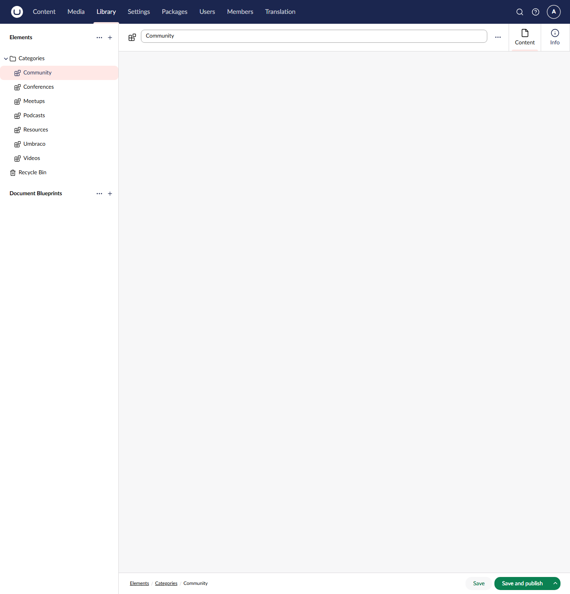

The other categories

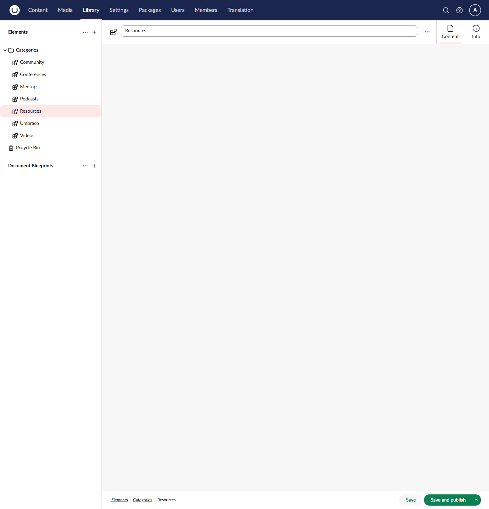

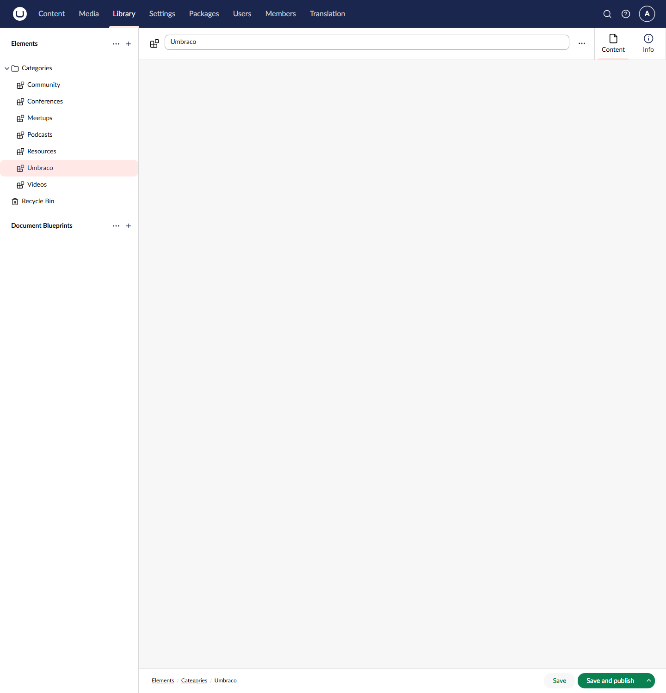

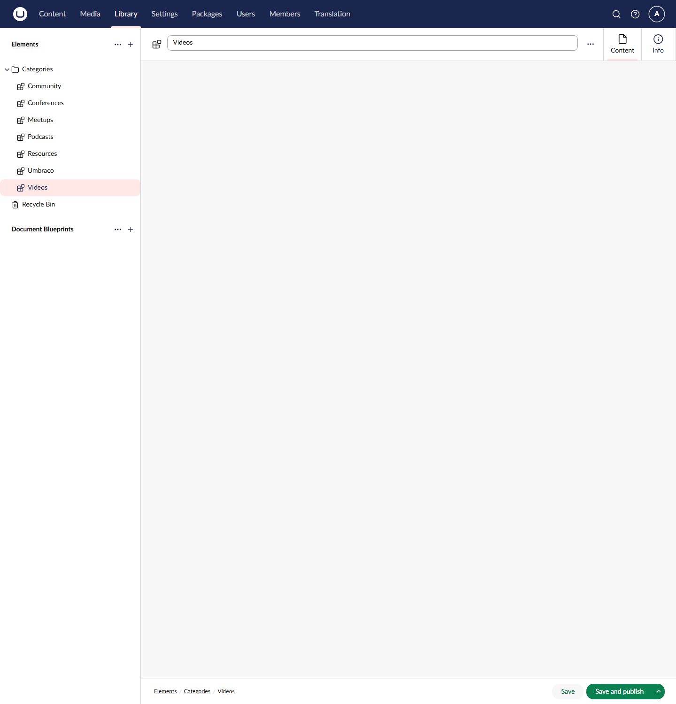

**Adding a category:** in the Library section, open the actions menu on the **Categories** folder, choose **Create** and then **Category Element**, give it a name, and choose **Save and publish**. It can then be picked in an article's **Categories** field on the **Article Details** tab.

On the website, an article's categories are shown as tags in its hero, sorted by name:

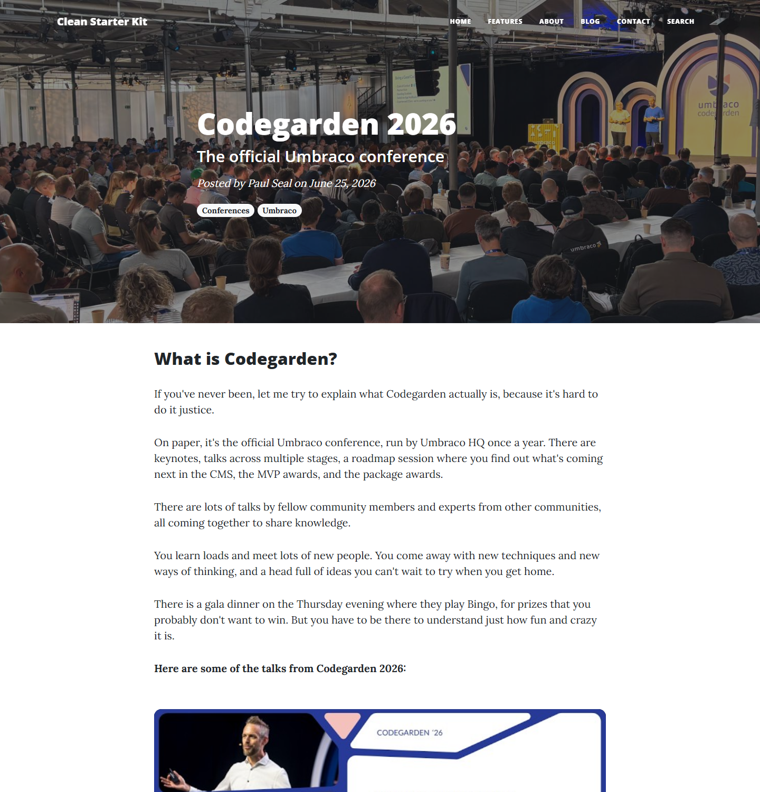

**Reusable blocks:** the Library also has a **Reusable Blocks** folder, with one Rich Text element, **Join the Umbraco Community**, which is placed on the Codegarden 2026 and Meetups articles. Editing it in the Library updates both pages. See [Reusable blocks](clean-features-blocks.md#reusable-blocks).

---

## Document types

Document types are in **Settings > Document Types**, in folders:

| Folder | Contains |
|--------|----------|
| `Pages` | The page types that editors create in the Content section |
| `Compositions` | The shared groups of fields that the page types are built from |
| `Compositions/Content Blocks/Setting Models` | The two compositions used by block settings: Hide Property and Spacing Properties |
| `Elements/Content Models` | The content element types for the blocks |
| `Elements/Setting Models` | The settings element types for the blocks |
| `Elements/Library Elements` | Category Element, used in the Library section |

### Page types

| Name | Alias | Allowed under | Compositions | Template |
|------|-------|---------------|--------------|----------|
| Home | `home` | The root | Content, Footer, Header, Main Image and SEO Controls | `home` |
| Content | `content` | Home | Content, Header, Main Image, SEO and Visibility Controls | `content` |
| Article List | `articleList` | Home | Content, Header, Main Image, SEO and Visibility Controls | `articleList` |
| Article | `article` | Article List | Article, Content, Header, Main Image, SEO and Visibility Controls | `article` |
| Author List | `authorList` | Home | Content, Header, Main Image, SEO and Visibility Controls | `AuthorList` |
| Author | `author` | Author List | Content, Header, Main Image, SEO and Visibility Controls | `Author` |
| Contact | `contact` | Home | Contact Form, Header, Main Image, SEO and Visibility Controls | `contact` |
| Search | `search` | Home | Header, Main Image, SEO and Visibility Controls | `search` |
| Error | `error` | Home | Content, Header, Main Image, SEO and Visibility Controls | `error` |
| XML Sitemap | `xMLSitemap` | Home | Visibility Controls | `xMLSitemap` |

Every page type is invariant (not varied by culture). See [Pages](clean-features-pages.md) for how each one looks and is edited.

---

## Compositions

The page types get their fields from compositions, so a field is defined once and behaves the same on every page.

| Composition | Alias | Tab | Fields |
|-------------|-------|-----|--------|
| Content Controls | `contentControls` | Content | Content Rows (`contentRows`, Main Content Block List) |
| Header Controls | `headerControls` | Hero | Title (`title`), Subtitle (`subtitle`) |
| Main Image Controls | `mainImageControls` | Hero | Main Image (`mainImage`, Single Image Media Picker) |
| SEO Controls | `sEOControls` | SEO | Meta Name, Meta Description, Meta Keywords, Is Indexable, Is Followable |
| Visibility Controls | `visibilityControls` | Visibility | Hide From Top Navigation, Hide From Search (`umbracoNaviHide`), Hide From XML Sitemap |
| Article Controls | `articleControls` | Article Details | Article Date (required), Author (required), Categories |
| Contact Form Controls | `contactFormControls` | Content, Result Messages | Instruction Message, Success Message (required), Error Message (required) |
| Footer Controls | `footerControls` | Footer | Social Icon Links (`socialIconLinks`, Social Links) |

Models Builder generates an interface for each composition, such as `IHeaderControls` or `IArticleControls`. Views use them to read fields from any page that has them. For example, the search results view checks `result is IArticleControls article` to show an author and date only for articles.

---

## Element types for blocks

Each block has a content element type and a settings element type. See [Content blocks](clean-features-blocks.md) for what each block does.

| Content model | Settings model | Settings compositions |
|---------------|----------------|-----------------------|
| Rich Text Row (`richTextRow`) | `richTextRowSettings` | Hide Property, Spacing Properties |
| Image Row (`imageRow`) | `imageRowSettings` | Hide Property, Spacing Properties |
| Video Row (`videoRow`) | `videoRowSettings` | Hide Property, Spacing Properties |
| Code Snippet Row (`codeSnippetRow`) | `codeSnippetRowSettings` | Hide Property, Spacing Properties |
| Image Carousel Row (`imageCarouselRow`) | `imageCarouselRowSettings` | Hide Property, Spacing Properties |
| Latest Articles Row (`latestArticlesRow`) | `latestArticlesRowSettings` | Hide Property, Spacing Properties |
| Icon Link Row (`iconLinkRow`) | `iconLinkRowSettings` | Hide Property |

Rich Text Row is the only element type with **Allow in Library** turned on, so Rich Text blocks are the only blocks that can be [reusable](clean-features-blocks.md#reusable-blocks).

---

## Data Types

Installing Clean arranges the Data Types tree into two folders, each with a sub-folder per family:

- **Clean** holds the starter kit's own Data Types.
- **Umbraco Defaults** holds Umbraco's built-in Data Types. They keep their names, keys and settings; the install only moves them into the folder.

Clean never changes a built-in Data Type. Anything that needs different settings is its own Data Type in the Clean folder.

| The Clean folder | The whole tree |
|------------------|----------------|
| 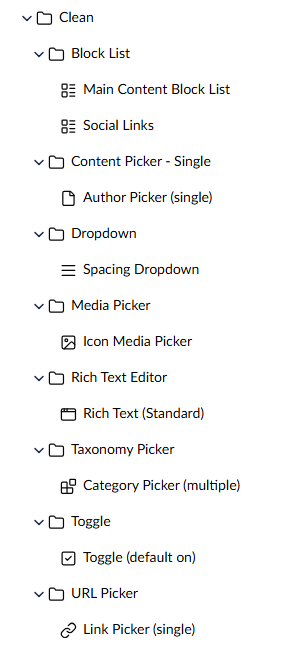 | 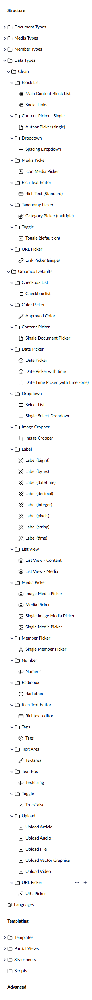 |

### Clean's Data Types

| Data Type | Folder | Property editor | Settings | Used by |
|-----------|--------|-----------------|----------|---------|
| Main Content Block List | Block List | Block List | The six content blocks, each with its settings model and label | Content Rows |
| Social Links | Block List | Block List | Icon Link Row | Social Icon Links (Home) |
| Author Picker (single) | Content Picker - Single | Document Picker | Opens at the nearest Author List below the Home page | Author (Article) |
| Spacing Dropdown | Dropdown | Dropdown | Unset, 0, 1, 2, 3, 4, 5 | The eight Spacing Properties fields |
| Icon Media Picker | Media Picker | Single Media Picker | Vector graphics (SVG) only | Icon (Icon Link Row) |
| Rich Text (Standard) | Rich Text Editor | Rich Text | Clean's toolbar, images up to 500 pixels | Rich Text Row, and the three Contact messages |
| Category Picker (multiple) | Taxonomy Picker | Element Picker | Picks any number of Library elements | Categories (Article) |
| Toggle (default on) | Toggle | Toggle | On by default | Is Indexable, Is Followable |
| Link Picker (single) | URL Picker | Single URL Picker | One link | Link (Icon Link Row) |

Clean's Data Type names say what the Data Type is for, with any constraint in brackets at the end, such as `Link Picker (single)` or `Toggle (default on)`.

### Built-in Data Types that Clean uses

Textstring, Textarea, Tags, True/false, Numeric, Date Picker with time, Single Document Picker, Single Image Media Picker and Image Media Picker, all in their stock configuration.

The Umbraco Defaults folder

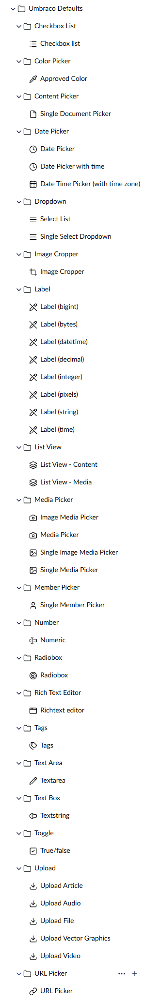

The Data Types tree in the Settings section

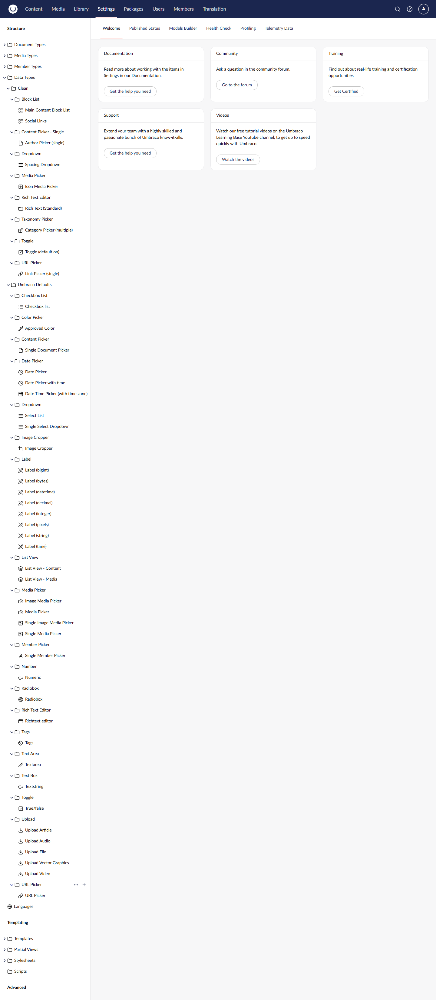

---

## Media types

Clean uses Umbraco's standard media types (Folder, Image, File, Video, Audio, Article and Vector Graphics). It adds one field to **Image**:

| Field | Alias | Data Type | Used for |
|-------|-------|-----------|----------|
| Alt Text | `altText` | Textarea | The `alt` attribute when an image is shown by the Image or Image Carousel block |

The `GetAltText()` extension method in `Clean.Core` reads it, and returns an empty string for media without the field.

The sample media (hero images, article images, author photos and social icons) is installed with the package.

---

## Templates

There is one template per page type, all using `master.cshtml` as their layout:

| Template | Page type |
|----------|-----------|
| `master` | The layout: `<head>` tags, navigation, footer, stylesheets and scripts |
| `home`, `content`, `articleList`, `article`, `AuthorList`, `Author`, `contact`, `search`, `error` | The matching page type |
| `xMLSitemap` | XML Sitemap. It does not use the layout; it writes XML |

The views are in `Views/`, with partials in `Views/Partials/`, block views in `Views/Partials/blocklist/Components/`, and view components (Contact and Pagination) in `Views/Components/`.

The front-end assets are in `wwwroot/assets/`: the Clean Blog theme's CSS (with Bootstrap 5), highlight.js and its copy button for code snippets, Swiffy Slider for the carousel, and `scripts.js` for the navigation and lazy-loaded YouTube videos. Fonts (Lora and Open Sans), Font Awesome and Bootstrap's JavaScript load from CDNs with Subresource Integrity hashes.

> **⚠️ Keeping your changes.** The `Clean` NuGet package installs these views and assets into your project. Once your site is running, switch to the `Clean.Core` package so later updates do not overwrite your changes. See [Package Architecture](clean-packages.md).

---

## Models Builder

`Clean.Blog` runs Models Builder in `SourceCodeManual` mode and writes the models to the `Clean.Models` project, which is committed to the repository. The `Clean.Core` code and the views use these strongly typed models, such as `Article`, `IArticleControls` and `RichTextRow`.

If you change a document type, element type, media type or composition, regenerate the models: **Settings > Models Builder > Generate models**. The [Contributing Guide](general-contributing.md#regenerating-models-builder-models) has the full steps.

---

Previous: [SEO, navigation and site settings](clean-features-seo-and-navigation.md) | Back to the [Feature Guide](clean-features.md)
