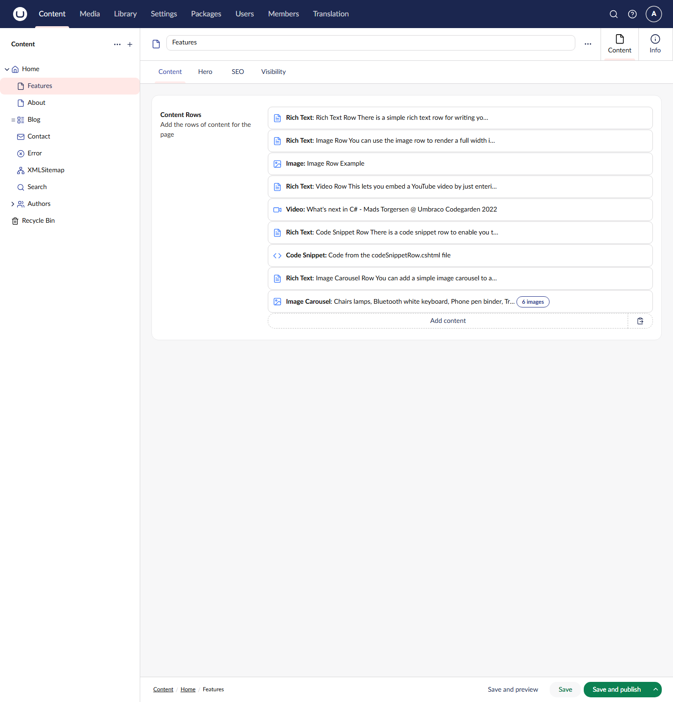
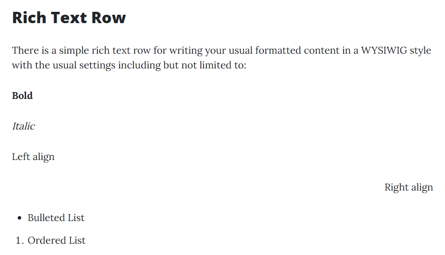
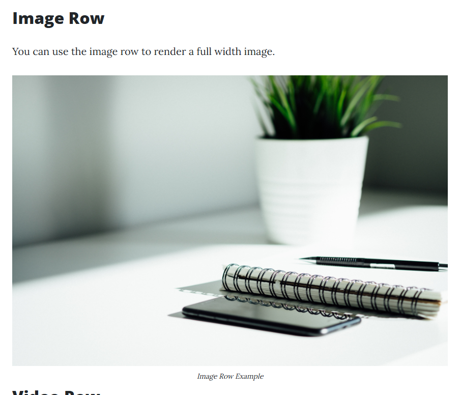
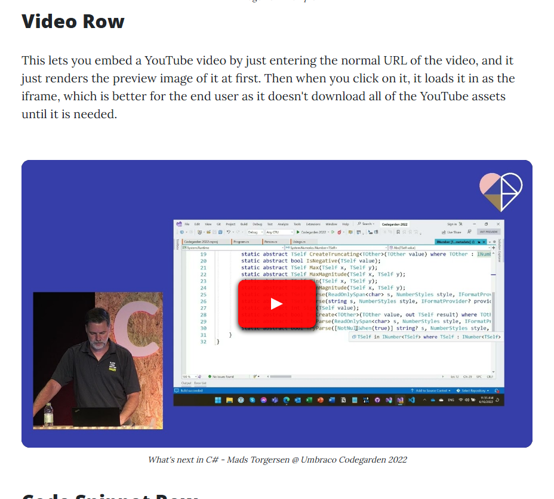
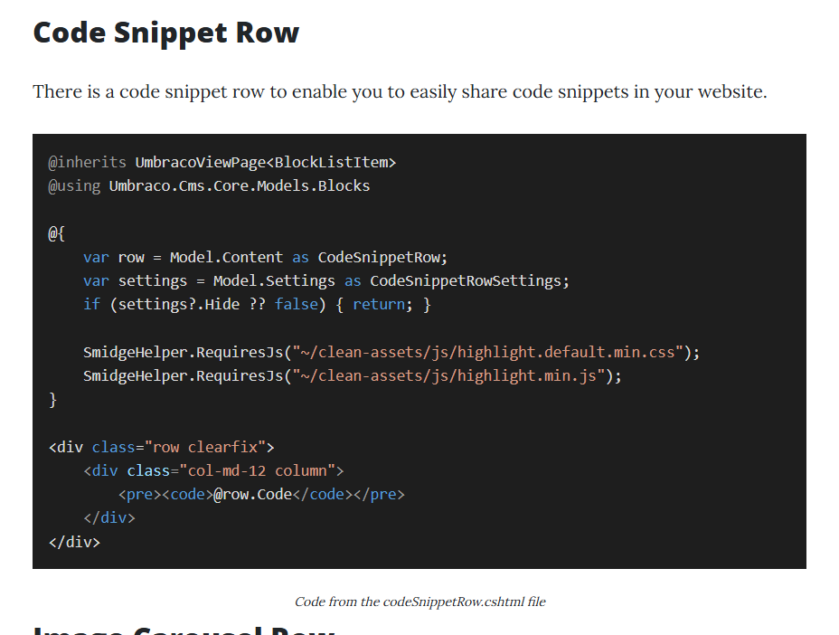
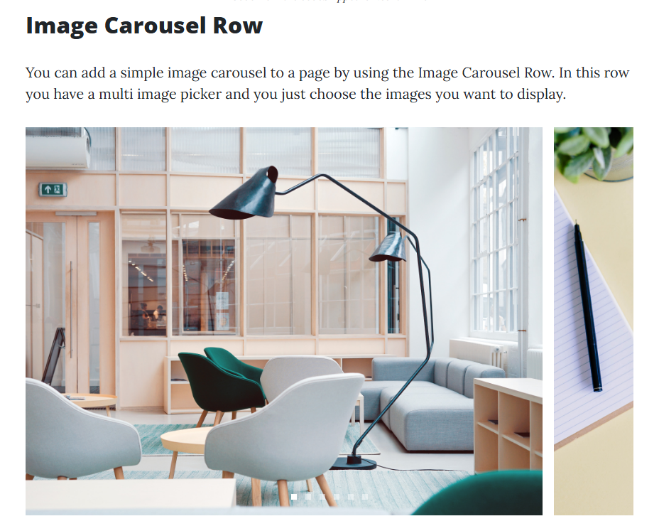
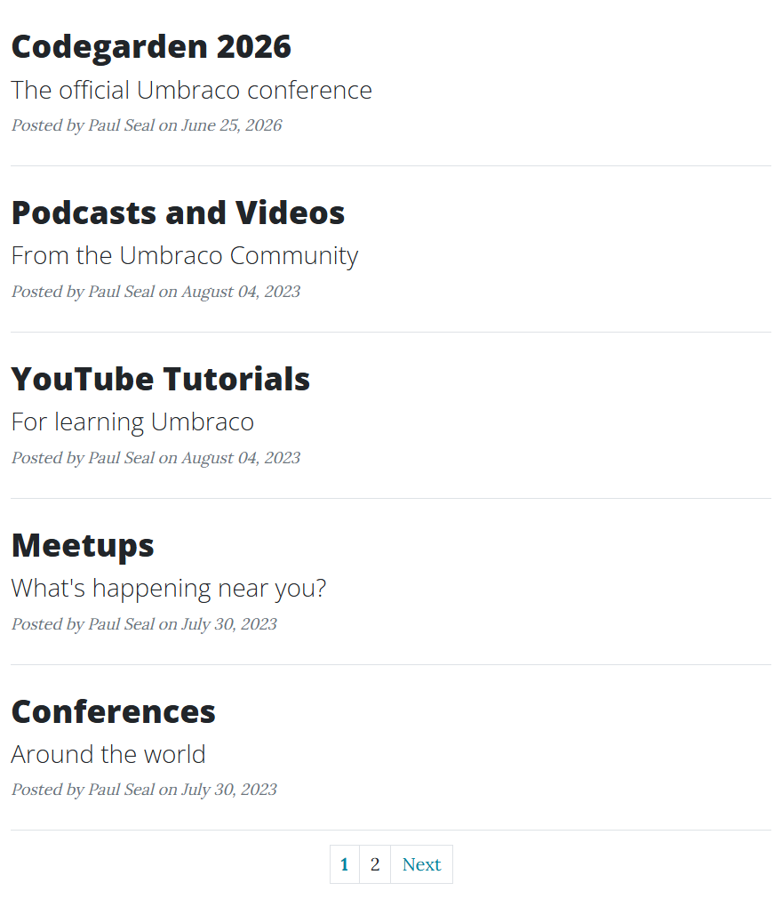
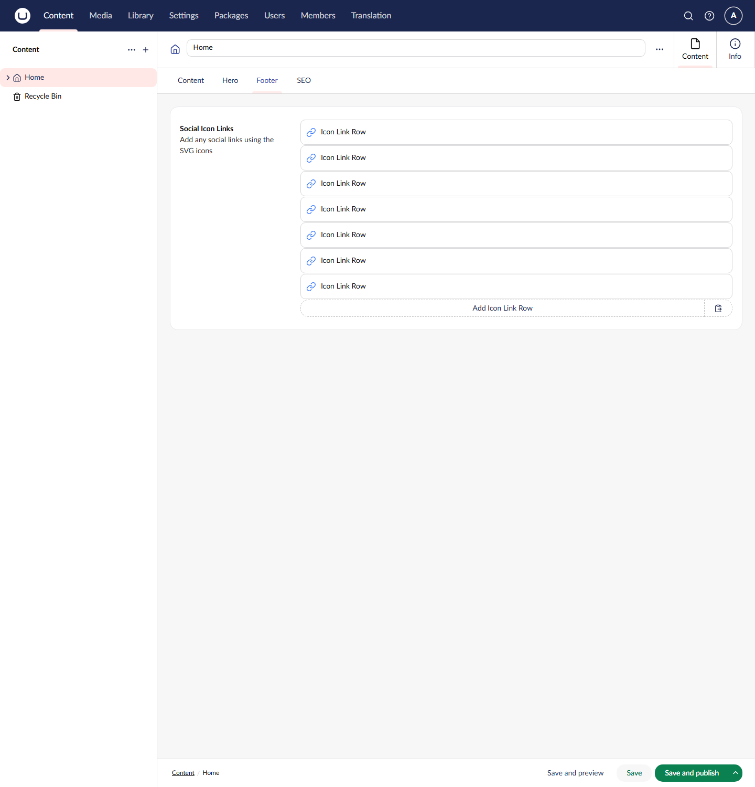

# Content Blocks

[Feature Guide](clean-features.md) > Content blocks

Every content page in Clean has a **Content Rows** field on its Content tab. It is a block list: editors build the body of the page by adding rows, one block at a time, and dragging them into order.

The [Features page](clean-features-pages.md#content-pages-features-and-about) in the sample content uses every block type, so it is the quickest way to see them all on a running site.

---

## Contents

- [The blocks](#the-blocks)
  - [Rich Text](#rich-text)
  - [Image](#image)
  - [Video](#video)
  - [Code Snippet](#code-snippet)
  - [Image Carousel](#image-carousel)
  - [Latest Articles](#latest-articles)
- [Block settings: spacing and hide](#block-settings-spacing-and-hide)
- [Social links (Icon Link Row)](#social-links-icon-link-row)
- [How the blocks are rendered](#how-the-blocks-are-rendered)
- [Adding your own block](#adding-your-own-block)

---

## The blocks

The **Main Content Block List** Data Type, used by Content Rows, offers six blocks. Each block's label in the backoffice previews its content, so editors can find a row without opening it.

| Block | Fields | Label in the backoffice |
|-------|--------|-------------------------|
| Rich Text | Rich Content | **Rich Text:** the first 60 characters of the text |
| Image | Image, Caption | **Image:** the caption |
| Video | Video Url, Caption | **Video:** the caption, or the URL if there is no caption |
| Code Snippet | Code, Title | **Code Snippet:** the title |
| Image Carousel | Images | **Image Carousel:** the image names and a count, such as "6 images" |
| Latest Articles | Article List, Page Size, Show Pagination | **_Blog_ Articles**, using the name of the chosen page |

A hidden block (see [Block settings](#block-settings-spacing-and-hide)) has **[HIDDEN]** added to its label.

### Rich Text

Formatted text, edited with the **Rich Text (Standard)** editor. Its toolbar has: source code, clear formatting, headings (H2, H3, H4), bold, italic, underline, left, centre and right alignment, bulleted and numbered lists, link, unlink, anchor, insert image from the media library and embedded media. Images inserted into the text are limited to 500 pixels.

### Image

One image from the media library, shown at the full width of the content column, with an optional caption underneath. The image's **Alt Text** (a field on the Image media type) is used as the `alt` attribute.

### Video

A YouTube video. Editors paste the normal YouTube URL, in any of these forms:

- `https://www.youtube.com/watch?v=<id>`
- `https://youtube.com/watch?v=<id>`
- `https://youtu.be/<id>`

The page first shows only the video's thumbnail with a play button. The YouTube player is loaded when the visitor clicks it, so a page with many videos stays fast and does not load YouTube's scripts until they are needed. The caption is optional. A URL that is not a YouTube video renders nothing.

### Code Snippet

A block of code with syntax highlighting (highlight.js, with the VS 2015 colour theme) and a copy button. The Title is shown as a caption underneath.

### Image Carousel

Several images from the media library in a slider (Swiffy Slider). Visitors can swipe, use the arrows or the indicators. Images are lazy-loaded, and each one uses its Alt Text.

### Latest Articles

Lists the articles under a chosen page, newest first by Article Date. Hidden articles (with **Hide From Search** turned on) are left out.

| Field | Required | Notes |
|-------|----------|-------|
| Article List | Yes | The page whose child articles are listed, normally the Blog page |
| Page Size | Yes | How many articles to show |
| Show Pagination | No | Shows page links underneath. Pages use the `?page=` query string |

Each article shows its title (or name), subtitle, author and date, and links to the article.

The sample content uses this block twice: on the Home page (3 articles, no pagination) and on the Blog page (5 articles, with pagination).

---

## Block settings: spacing and hide

Every block has a settings model, opened from the block's **Settings** tab in the backoffice. The settings models are built from two compositions:

- **Hide Property**: a **Hide** toggle. A hidden block stays on the page in the backoffice, labelled **[HIDDEN]**, but is not rendered on the website. Use it to take a block down without losing it.
- **Spacing Properties**: padding and margin for each side (top, bottom, left and right), each picked from the **Spacing Dropdown**: Unset, 0, 1, 2, 3, 4 or 5.

The spacing values map to Bootstrap 5 spacing classes on the block's wrapper:

| Setting | Class | Setting | Class |
|---------|-------|---------|-------|
| Padding Top | `pt-<n>` | Margin Top | `mt-<n>` |
| Padding Bottom | `pb-<n>` | Margin Bottom | `mb-<n>` |
| Padding Left | `ps-<n>` | Margin Left | `ms-<n>` |
| Padding Right | `pe-<n>` | Margin Right | `me-<n>` |

**Unset** adds no class, so the theme's default spacing applies. The classes are built by `SpacingHelper` in `Clean.Core`.

| Block | Hide | Spacing |
|-------|:----:|:-------:|
| Rich Text, Image, Video, Code Snippet, Image Carousel, Latest Articles | ✓ | ✓ |
| Icon Link Row | ✓ | |

---

## Social links (Icon Link Row)

The Home page's **Footer** tab has a second block list, **Social Links**, with one block type: **Icon Link Row**.

| Field | Required | Notes |
|-------|----------|-------|
| Icon | Yes | An SVG from the media library (the **Icon Media Picker** only accepts vector graphics) |
| Link | Yes | One link. External links get `rel="noopener"` |

The icons are written into the page as inline SVG by the `<our-svg>` tag helper in `Clean.Core`, so they take the text colour of the theme. They appear in the footer of every page:

---

## How the blocks are rendered

Each page view calls `@Html.GetBlockListHtml(Model.ContentRows)`. That renders `Views/Partials/blocklist/default.cshtml`, which loops through the blocks and renders a partial view named after each block's element type alias:

| Block | Element type alias | Partial view |
|-------|--------------------|--------------|
| Rich Text | `richTextRow` | `Views/Partials/blocklist/Components/richTextRow.cshtml` |
| Image | `imageRow` | `Views/Partials/blocklist/Components/imageRow.cshtml` |
| Video | `videoRow` | `Views/Partials/blocklist/Components/videoRow.cshtml` |
| Code Snippet | `codeSnippetRow` | `Views/Partials/blocklist/Components/codeSnippetRow.cshtml` |
| Image Carousel | `imageCarouselRow` | `Views/Partials/blocklist/Components/imageCarouselRow.cshtml` |
| Latest Articles | `latestArticlesRow` | `Views/Partials/blocklist/Components/latestArticlesRow.cshtml` |
| Icon Link Row | `iconLinkRow` | `Views/Partials/blocklist/Components/iconLinkRow.cshtml` |

Each partial reads its strongly typed content and settings models (for example `RichTextRow` and `RichTextRowSettings`), returns early if the block is hidden, and adds the spacing classes.

---

## Adding your own block

1. In **Settings > Document Types**, create an element type for the content under **Elements/Content Models** (for example `quoteRow`) and one for its settings under **Elements/Setting Models** (`quoteRowSettings`). Add the **Hide Property** and **Spacing Properties** compositions to the settings element.
2. Open the **Main Content Block List** Data Type (in the **Clean/Block List** folder) and add the new block, with its settings model and a label.
3. Create `Views/Partials/blocklist/Components/quoteRow.cshtml`. Copying `richTextRow.cshtml` is a good start: it already handles the hide toggle and the spacing classes.
4. If your project runs Models Builder in `SourceCodeManual` mode, as `Clean.Blog` does, regenerate the models so `QuoteRow` and `QuoteRowSettings` exist.

---

Previous: [Pages](clean-features-pages.md) | Next: [SEO, navigation and site settings](clean-features-seo-and-navigation.md)
