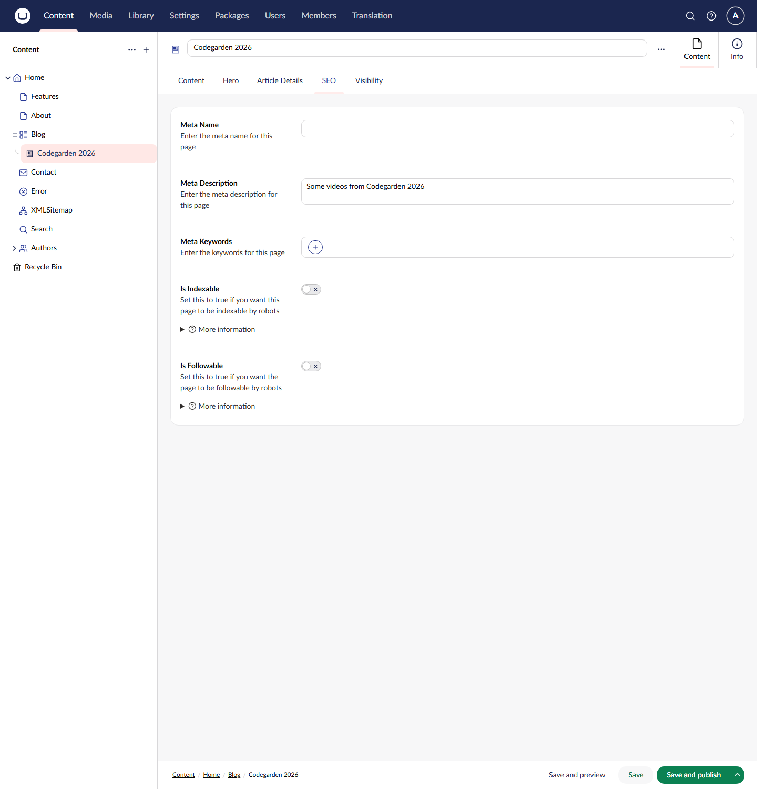
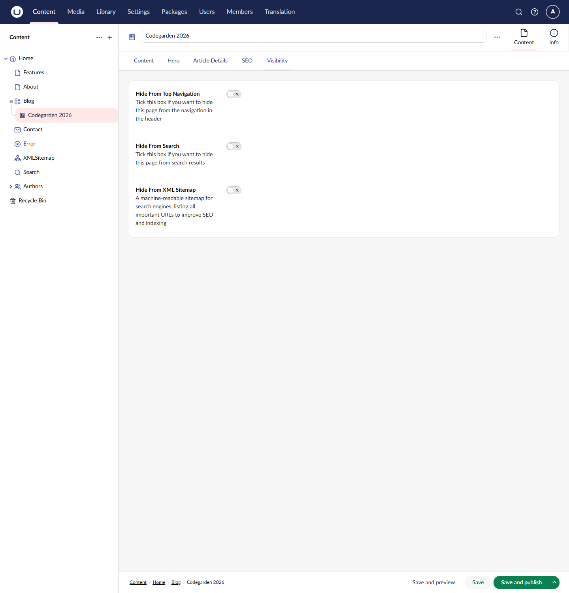
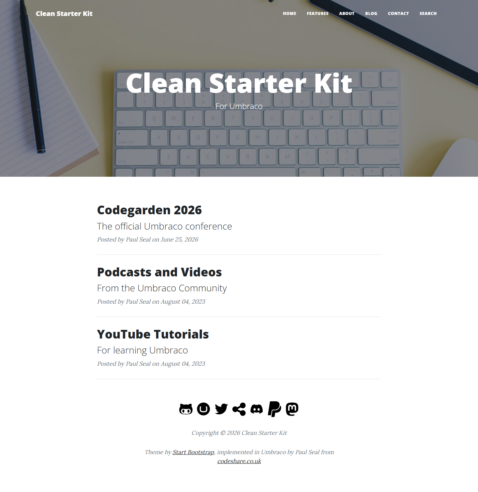
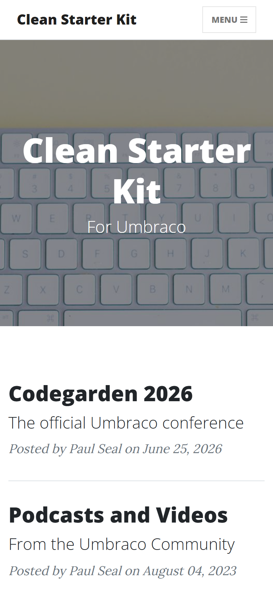
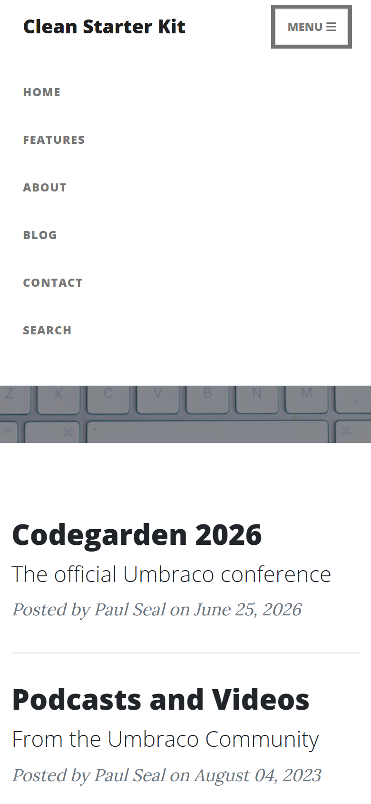
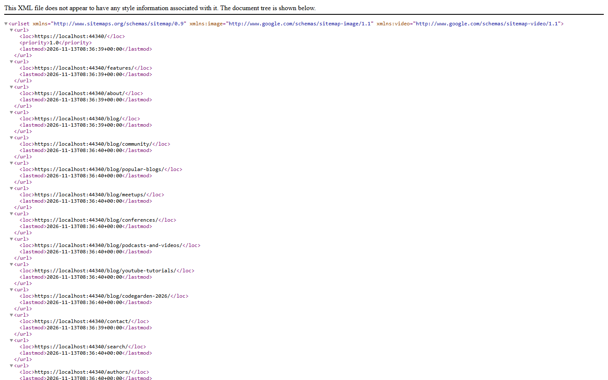
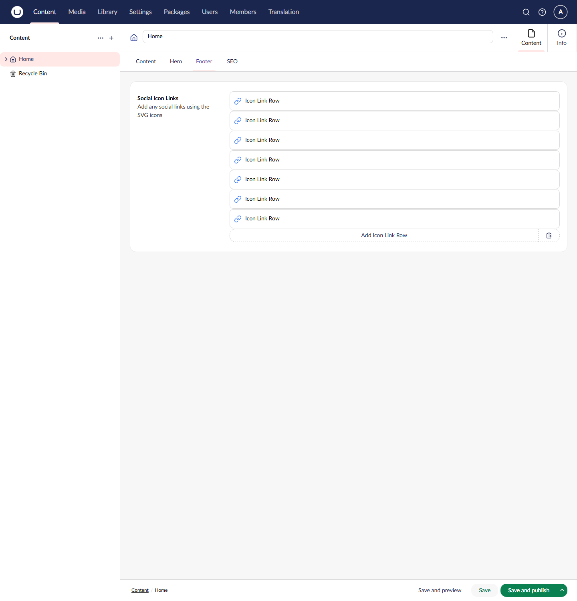

# SEO, Navigation and Site Settings

[Feature Guide](clean-features.md) > SEO, navigation and site settings

This page covers the features that apply across the whole site: the SEO fields, the visibility toggles, the main navigation, the XML sitemap, the footer, the dictionary items used for fixed text, and the security headers.

---

## Contents

- [SEO](#seo)
- [Visibility](#visibility)
- [Main navigation](#main-navigation)
- [XML sitemap](#xml-sitemap)
- [Footer and social links](#footer-and-social-links)
- [Site text and translations (dictionary items)](#site-text-and-translations-dictionary-items)
- [Security headers](#security-headers)

---

## SEO

Every page type except XML Sitemap has an **SEO** tab, from the **SEO Controls** composition.



| Field | Data Type | Used for |
|-------|-----------|----------|
| Meta Name | Textstring | `<meta name="Name">`, `og:title` and `twitter:title` |
| Meta Description | Textarea | `<meta name="Description">`, `og:description` and `twitter:description`. On the Authors page it is also the summary on each author's card |
| Meta Keywords | Tags | `<meta name="Keywords">`, comma separated |
| Is Indexable | Toggle (default on) | `INDEX` or `NOINDEX` in the robots tag |
| Is Followable | Toggle (default on) | `FOLLOW` or `NOFOLLOW` in the robots tag |

Each toggle has a **More information** section in the backoffice that explains what it does for search engines.

### What is written into the page

`Views/Partials/metaData.cshtml` writes the `<head>` tags for every page:

```html
<title>Codegarden 2026 | Clean Starter Kit</title>
<meta name="Description" content="Some videos from Codegarden 2026" />
<meta name="Name" content="..." />
<meta name="Keywords" content="..." />
<meta name="robots" content="FOLLOW,INDEX" />
<link rel="canonical" href="https://example.com/blog/codegarden-2026/" />

<meta property="og:type" content="article" />
<meta property="og:url" content="https://example.com/blog/codegarden-2026/" />
<meta property="og:title" content="..." />
<meta property="og:description" content="..." />
<meta property="og:image" content="https://example.com/socialimage.png">

<meta name="twitter:card" content="summary_large_image">
...
```

- The `<title>` is the page name followed by the **Navigation.SiteName** dictionary item.
- The canonical URL and `og:url` are the page's absolute URL, using the Home page's domain.
- A page without SEO fields (XML Sitemap) takes its robots settings from the nearest ancestor that has them.

> **⚠️ Robots settings in the sample content.** The Is Indexable and Is Followable toggles are **off** on the sample pages, so every page renders `<meta name="robots" content="NOFOLLOW,NOINDEX" />`. This keeps a new site out of search engines while you build it. New pages you create default to on. Turn the toggles on for the sample pages you keep before you go live.

> **ℹ️ Social sharing image.** The `og:image` and `twitter:image` tags point to `/socialimage.png` at the root of the site. The starter kit does not ship that file, so add your own image at `wwwroot/socialimage.png` (1200 × 630 pixels works well for most networks).

---

## Visibility

Every page type except Home has three toggles, from the **Visibility Controls** composition. They appear on their own **Visibility** tab.



| Field | Alias | Effect |
|-------|-------|--------|
| Hide From Top Navigation | `hideFromTopNavigation` | Leaves the page out of the main navigation |
| Hide From Search | `umbracoNaviHide` | Leaves the page out of article listings (the Latest Articles block), the authors list and the XML sitemap |
| Hide From XML Sitemap | `hideFromXMLSitemap` | Leaves the page, and the pages below it, out of the XML sitemap |

**Hide From Search** uses Umbraco's built-in `umbracoNaviHide` alias, which Umbraco's `IsVisible()` extension method checks. Clean's views call `IsVisible()` when they list articles, authors and sitemap entries. The search page filters out the Error, Search and XML Sitemap page types, but it does not read this toggle, so a page with Hide From Search turned on can still appear in search results.

---

## Main navigation



`Views/Partials/mainNavigation.cshtml` builds the menu at the top of every page:

- The site name on the left is the **Navigation.SiteName** dictionary item, linking to the Home page.
- The menu has a link to the Home page, then a link to each page directly under Home, in the order they appear in the content tree. Pages with **Hide From Top Navigation** turned on are skipped.
- The menu is one level deep. Pages further down the tree, such as articles, are not in it.
- On small screens the menu collapses behind a button labelled with the **Navigation.MenuTitle** dictionary item.

| Collapsed | Open |
|-----------|------|
|  |  |

To change the order of the menu, sort the pages under Home in the backoffice (**Sort children** in the Home page's actions menu).

The navigation and footer are rendered with `Html.CachedPartialAsync` and cached for 60 minutes. Umbraco clears that cache when content is published, so changes show straight away.

---

## XML sitemap

The **XMLSitemap** page outputs a sitemap in the [sitemaps.org](https://www.sitemaps.org/protocol.html) format at `/xmlsitemap/`, with the `text/xml` content type.



- The Home page is first, with a priority of `1.0`.
- Every page below Home follows, walking the tree in order. Each entry has its absolute URL and a `lastmod` date taken from the page's last update.
- A page is left out, along with the pages below it, if it has **Hide From XML Sitemap** or **Hide From Search** turned on.
- The output is cached for 60 minutes.

To tell search engines where the sitemap is, add a `robots.txt` to `wwwroot`, for example:

```text
User-agent: *
Allow: /

Sitemap: https://example.com/xmlsitemap/
```

---

## Footer and social links

`Views/Partials/footer.cshtml` renders the footer on every page:


- **Social icons**: the **Social Icon Links** on the Home page's **Footer** tab. Each one is an SVG icon and a link. See [Social links (Icon Link Row)](clean-features-blocks.md#social-links-icon-link-row).
- **Copyright line**: "*Footer.CopyrightTitle* © *current year* *Footer.CopyrightStatement*", built from two dictionary items.
- **Theme credit**: a line crediting Start Bootstrap and the starter kit, written in the view. Edit `footer.cshtml` to change or remove it.



---

## Site text and translations (dictionary items)

Fixed text in the views, such as button labels and form labels, comes from dictionary items rather than being written into the views. Edit them in the **Translation** section of the backoffice, or add another language under **Settings > Languages** and translate them.

| Key | Default text (en-US) | Where it appears |
|-----|----------------------|------------------|
| `Navigation.SiteName` | Clean Starter Kit | The site name in the navigation, and the end of every `<title>` |
| `Navigation.MenuTitle` | Menu | The menu button on small screens |
| `Article.Posted` | Posted | Article bylines |
| `Article.By` | by | Article bylines |
| `Article.On` | on | Article bylines |
| `Author.ReadMore` | Read More | The link on each author card |
| `ContactForm.Name` | Name | The contact form |
| `ContactForm.Email` | Email Address | The contact form |
| `ContactForm.Message` | Message | The contact form |
| `ContactForm.Send` | Send | The contact form's button |
| `Search.Placeholder` | Search... | The search box |
| `Search.SearchButton` | Search | The search button |
| `Search.Results` | `<p>We found <strong>{0}</strong> results when searching for <strong>{1}</strong></p>` | Above the search results. `{0}` is the number of results and `{1}` is the search term |
| `Paging.Previous` | Prev | Pagination |
| `Paging.Next` | Next | Pagination |
| `Footer.CopyrightTitle` | Copyright | The footer |
| `Footer.CopyrightStatement` | Clean Starter Kit | The footer |
| `ArticleList.ViewAll` | View all posts | Not used by the Razor views |
| `Paging.Page` | Page | Not used by the Razor views |
| `Paging.Of` | of | Not used by the Razor views |

The items not used by the Razor views are there for headless front ends, which can read every item through the dictionary API (`GET /api/v1/dictionary/getdictionarytranslations`). See [Headless/API Implementation](clean-headless-api.md).

After installing Clean, save one dictionary item in the Translation section, as the [installation steps](../README.md#getting-started) say.

---

## Security headers

`Clean.Blog` adds security headers to every response through `Middleware/SecurityHeadersMiddleware.cs`. A header already set by something else is left alone.

| Header | Value |
|--------|-------|
| `X-Frame-Options` | `SAMEORIGIN` |
| `Content-Security-Policy` | A default policy that allows the site itself, jsDelivr, Font Awesome, Google Fonts and YouTube embeds. Configurable, see below |
| `X-Content-Type-Options` | `nosniff` |
| `X-XSS-Protection` | `1; mode=block` |
| `Referrer-Policy` | `strict-origin-when-cross-origin` |
| `Permissions-Policy` | `geolocation=(), microphone=(), camera=()` |
| `Strict-Transport-Security` | `max-age=31536000; includeSubDomains`, on HTTPS requests only |

To use your own Content Security Policy, for example to allow another script or font host, set it in `appsettings.json`. An empty value uses the default.

```json
{
  "SecurityHeaders": {
    "ContentSecurityPolicy": "default-src 'self'; script-src 'self' https://cdn.example.com; ..."
  }
}
```

The middleware is part of the `Clean.Blog` project and the `dotnet new` template. It is not in the `Clean` NuGet package, so a site that installs the package needs its own security headers.

---

Previous: [Content blocks](clean-features-blocks.md) | Next: [Backoffice structure](clean-features-backoffice.md)
