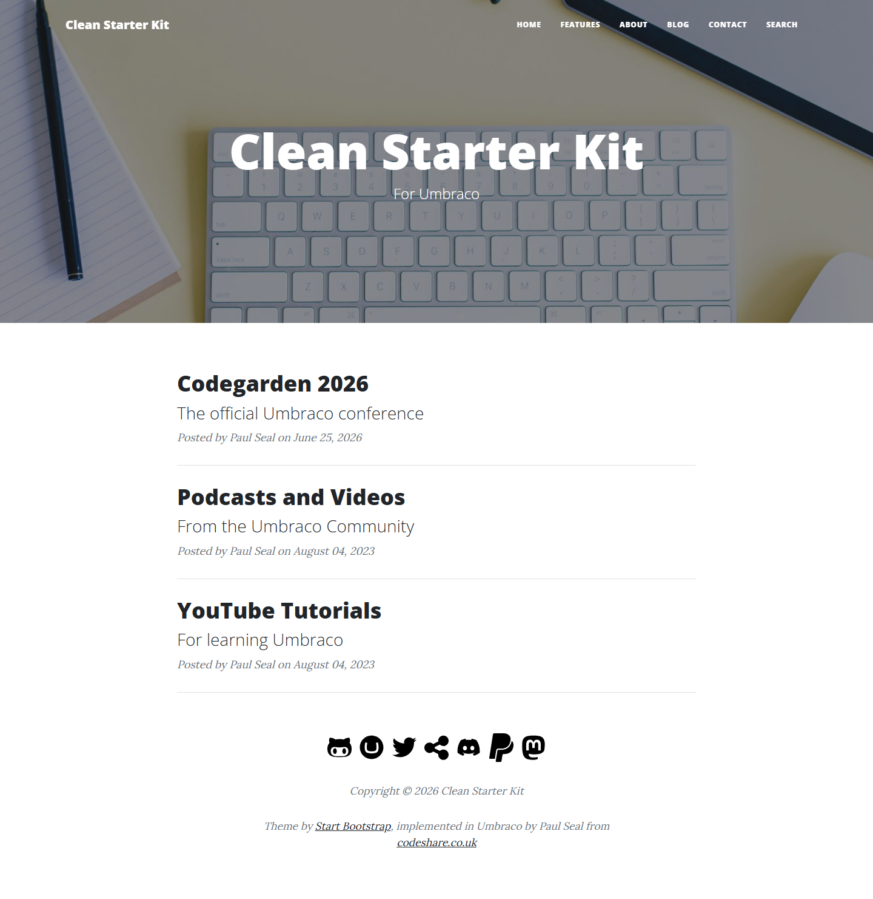
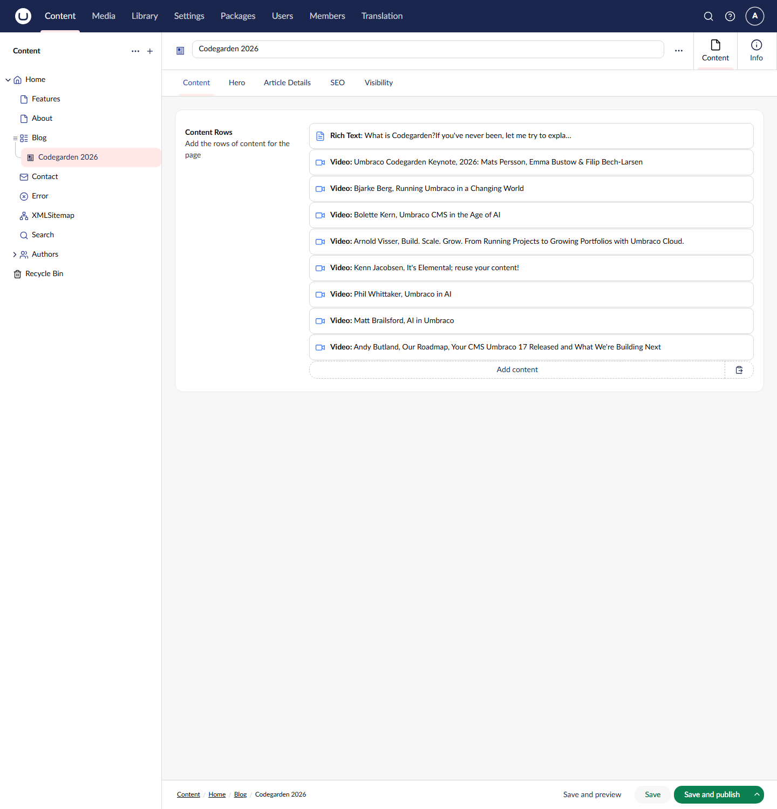
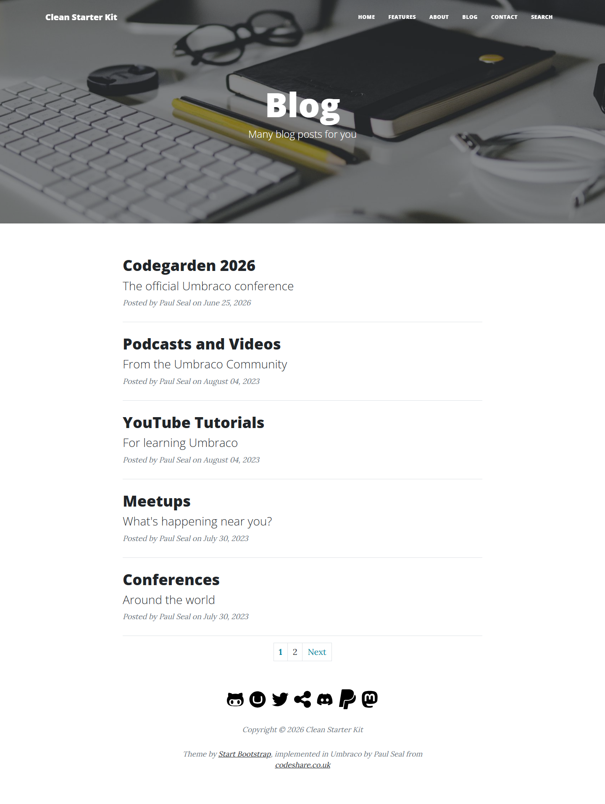
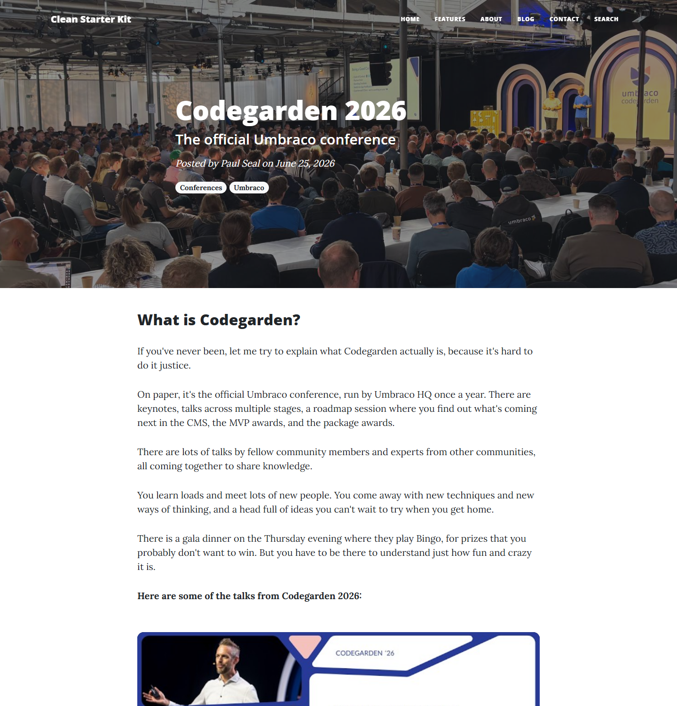
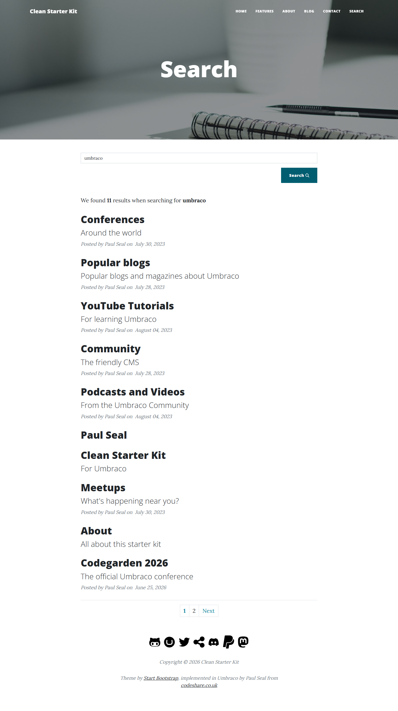
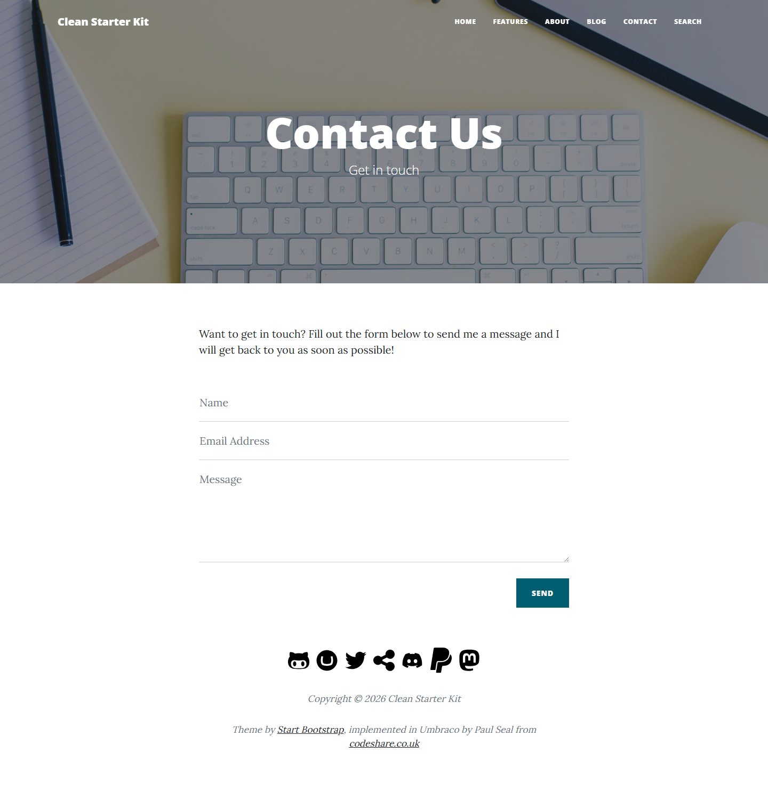
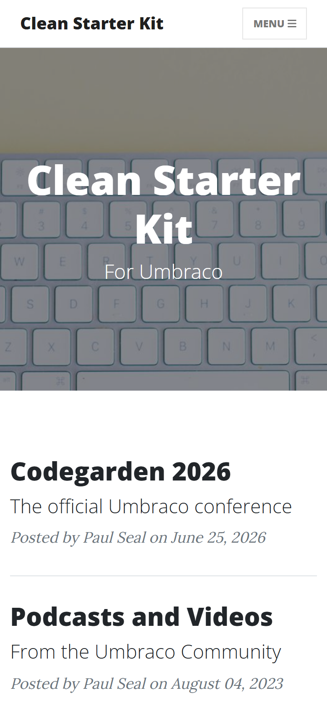
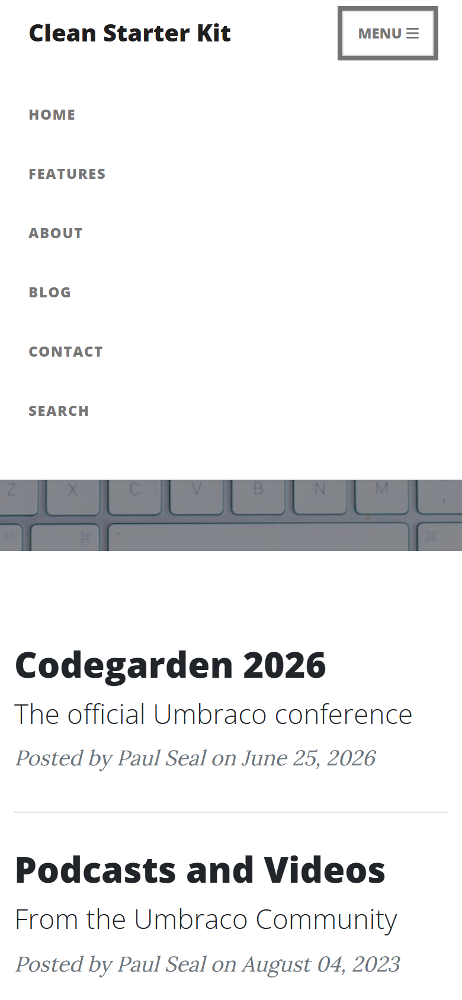

# Clean Starter Kit - Feature Guide

Clean is a starter kit for Umbraco 19 that gives you a complete, working blog website as soon as it is installed. It is based on the [Clean Blog](https://startbootstrap.com/theme/clean-blog) theme from Start Bootstrap (Bootstrap 5) and comes with sample content, a set of reusable content blocks, search, a contact form, an XML sitemap, SEO controls and a headless API.

This guide walks through what you get, with screenshots of the website and of the Umbraco backoffice. For installation, see the [README](../README.md).



---

## The guide

| Page | What it covers |
|------|----------------|
| [Pages](clean-features-pages.md) | Every page type in the starter kit: what it looks like on the website and how it is edited in the backoffice |
| [Content blocks](clean-features-blocks.md) | The rows editors use to build pages: rich text, image, video, code snippet, image carousel and latest articles, plus the spacing and hide settings |
| [SEO, navigation and site settings](clean-features-seo-and-navigation.md) | Meta tags, robots settings, the main navigation, the XML sitemap, the footer and social links, and the dictionary items used for site text |
| [Backoffice structure](clean-features-backoffice.md) | The document types and compositions, the Library section with its categories, the Data Types tree, and the media types |

Related documentation:

- [Headless/API Implementation](clean-headless-api.md): the Delivery API, the custom search, dictionary and contact endpoints, and Next.js revalidation
- [Package Architecture](clean-packages.md): the four NuGet packages and when to use each one

---

## Features at a glance

**For visitors**

- A responsive blog theme with a full-width hero image on every page and a collapsing menu on small screens
- A blog with paged article listings, author bylines, publish dates and category tags
- Author profile pages and an authors listing
- Site search with paged results
- A 404 page for missing URLs
- A contact form that sends an email
- Lazy-loaded YouTube videos, a touch-friendly image carousel and highlighted code snippets with a copy button
- Social icon links in the footer

**For editors**

- One block list editor ("Content Rows") on every content page, with six block types
- Per-block settings for spacing, and a toggle to hide a block without deleting it
- Title, subtitle and hero image on every page, with sensible fallbacks
- SEO fields on every page: meta name, description, keywords, and robots index and follow toggles
- Visibility toggles to keep a page out of the top navigation, the XML sitemap or search results
- Reusable categories stored once in the Library section and picked on each article
- All fixed site text (button labels, form labels, paging text) in dictionary items, so it can be changed or translated in the Translation section

**For developers**

- Strongly typed Models Builder models, shipped in the `Clean.Models` project
- Search built on Umbraco Search (`ISearcher`), shared by the search page and the search API
- Security headers middleware with a configurable Content Security Policy
- A headless API (`Clean.Headless`) with OpenAPI documentation and Next.js revalidation hooks
- A `dotnet new` template, or a NuGet package you can add to an existing Umbraco site

---

## Site structure

The sample content installs this tree under the Content section:

```
Home                      (Home)
├── Features              (Content)
├── About                 (Content)
├── Blog                  (Article List)
│   ├── Codegarden 2026   (Article)
│   ├── YouTube Tutorials (Article)
│   ├── Podcasts and Videos
│   ├── Conferences
│   ├── Meetups
│   ├── Popular blogs
│   └── Community
├── Contact               (Contact)
├── Error                 (Error)
├── XMLSitemap            (XML Sitemap)
├── Search                (Search)
└── Authors               (Author List)
    └── Paul Seal         (Author)
```



Every page that has a template is shown in the [Pages](clean-features-pages.md) guide.

---

## A quick tour of the website

### Desktop

Every page shares the same layout: the site name and main navigation at the top, a hero image with the page title and subtitle, the page content in a centred column, and a footer with social icons and the copyright line.

| Blog | Article |
|------|---------|
|  |  |

| Search results | Contact |
|----------------|---------|
|  |  |

### Mobile

On small screens the navigation collapses behind a **Menu** button.

| Home on a phone | Menu open |
|-----------------|-----------|
|  |  |

---

## About the screenshots

The backoffice screenshots in this guide were taken from a site installed from the `Clean` 19.0.0-rc02 package. The website screenshots were taken from the `Clean.Blog` project in this repository with its sample content, at 1440 pixels wide for desktop and 390 pixels wide for mobile. They live in `.github/images/backoffice` and `.github/images/frontend`.
